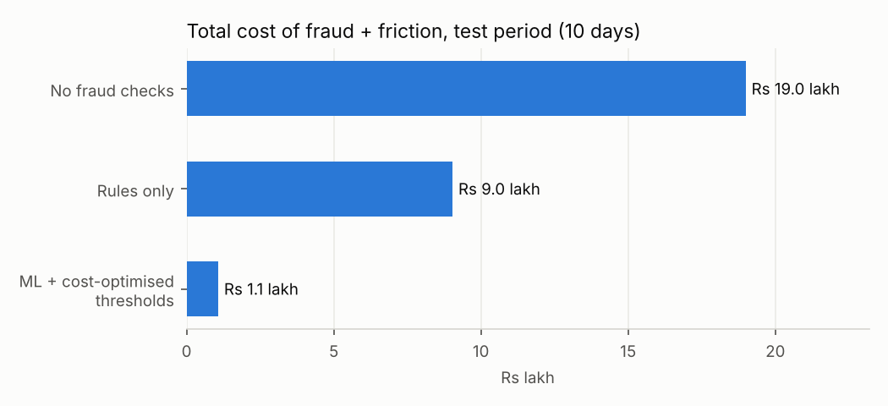

# UPI Fraud Shield — real-time payment fraud detection, end to end

A Python system that scores every UPI payment in milliseconds and decides
**APPROVE**, **STEP_UP** (re-authenticate) or **BLOCK**, with reasons a
customer-support agent can read.

## 1. The problem

India's UPI processes well over ten billion payments a month, and digital
payment fraud has grown with it. Two patterns dominate:

| Pattern | What happens | Why it is hard |
|---|---|---|
| **Account takeover** | Fraudster gets control of the account (SIM swap, stolen credentials, or a remote-access app like a screen-sharing tool on the victim's own phone) and drains it in minutes to "mule" accounts | Has to be stopped *during* the burst; remote-access attacks come from the victim's real device |
| **Social-engineering scam** | Victim is tricked ("refund", "KYC update", fake job) into approving a payment or collect request themselves | The victim's own phone, PIN and behaviour — no technical red flag |

The hard part isn't only catching fraud. Fraud is roughly **1 in 450 payments**,
so a system that blocks too eagerly harms thousands of genuine customers for
every fraudster it stops. The real objective is **minimum total rupee cost**:
fraud losses + customer friction + wrongly blocked payments + review effort,
within the operations team's capacity.

## 2. Solution architecture

```
 payment ──► guardrails ──► feature store ──► model ──► cost-optimised ──► decision
             (UPI limit,    (point-in-time,   (gradient   thresholds        + reason codes
              bad input)     velocity, device, boosting)  APPROVE/STEP_UP/
                             payee fan-in)                BLOCK
                                  ▲                                 │
                                  └──────── state updated ◄─────────┘
 offline: simulate ► features ► time split ► train ► tune thresholds ► test ► drift (PSI)
```

| Module | Responsibility |
|---|---|
| `data_generator.py` | 60 days of synthetic UPI traffic: 4,000 customers, merchants, mule networks, hard legit cases (new phones, rent, bill splitting, night owls) |
| `features.py` | **Point-in-time feature store**, 21 features. One class used for training *and* live scoring → no leakage, no training/serving skew |
| `model.py` | Time-based split, logistic-regression baseline, gradient-boosting model, PR-AUC metrics |
| `rules.py` | Hard guardrails + a typical hand-written rule set as the baseline to beat |
| `decision.py` | Two thresholds chosen to **minimise rupee cost** under a block-rate cap (prefix-sum grid search) |
| `explain.py` | Model-faithful reason codes by occlusion ("risk drops most when we neutralise the amount spike") |
| `monitoring.py` | Population Stability Index drift report per feature and on the score |
| `service.py` / `api.py` | Thread-safe scorer + FastAPI endpoint `/v1/score` |
| `pipeline.py` | Runs everything and writes `reports/` + `artifacts/` |

## 3. Results (unseen 10-day test period, 60,878 payments, 113 frauds)



| Strategy | Total cost | Fraud ₹ prevented | Fraud txns caught | Genuine customers challenged |
|---|---|---|---|---|
| No checks | ₹19.0 lakh | 0% | 0% | 0 |
| Rules only | ₹9.0 lakh | 52.6% | 34.5% | 111 |
| **ML + cost-optimised thresholds** | **₹1.1 lakh** | **95.6%** | **90.3%** | 303 (0.5% of traffic) |

* **88% lower total cost than rules** (₹7.96 lakh saved in 10 days on 4,000 customers).
* Account takeover: 98% caught. Scams: 83% caught — the harder pattern, as in reality.
* Gradient boosting PR-AUC **0.83** vs 0.54 for logistic regression.
* Scoring latency ~15–25 ms per payment, including reason codes.

Numbers come from `reports/metrics.json` and change slightly per run.

Example decisions (`python demo.py`):

```
=== Account takeover: new phone, 2 a.m., rapid transfers
  Rs    18,000 -> BLOCK    risk=0.9999
      - Amount far above this customer's usual spending
      - Receiving account has a risky profile
=== Scam: 'refund' collect request on own phone
  Rs     3,534 -> BLOCK    risk=0.0945
      - Amount far above this customer's usual spending
      - Receiving account has a risky profile
      - Collect request or person-to-person transfer
```

## 4. Design decisions worth discussing in an interview

1. **Leakage-proof features.** Features are computed *before* each payment is
   added to state; a unit test proves batch replay equals live scoring.
2. **Time-based validation.** Burn-in (days 0–13) → train (14–39) → tune
   thresholds (40–49) → test (50–59). Random splits leak the future.
3. **Optimise money, not accuracy.** Thresholds come from a cost model in
   `config.py` (missed fraud = full amount, step-up = ₹15 friction and stops
   60% of fraud, wrong block = ₹250, review = ₹40) with a 0.5% block-rate cap.
4. **Three actions, not two.** Step-up handles the grey zone cheaply; blocks
   are reserved for high confidence.
5. **Stationary features.** Ever-growing counts (history length, account age)
   are capped or turned into rates, otherwise the model drifts by construction —
   the PSI report caught this during development.
6. **Explainability.** Every challenged payment carries reason codes, which
   regulators and support teams need.

## 5. Run it

```bash
pip install -r requirements.txt
python run_pipeline.py                 # ~1 min: data → model → reports/ + artifacts/
python demo.py                         # score example scenarios
python -m unittest discover tests -v   # 13 tests (pytest also works)
uvicorn fraudshield.api:app --app-dir src --port 8000   # API docs at /docs
```

```bash
curl -X POST localhost:8000/v1/score -H "Content-Type: application/json" -d '{
  "txn_id":"T1","timestamp":"2026-09-01T02:14:00","user_id":"U00042",
  "payee_id":"U04012","amount":24999,"txn_type":"P2P","device_id":"F123456"}'
```

## 6. Limitations and next steps

* Data is simulated; real labels arrive late (chargebacks take weeks) and are noisy.
* State lives in memory; production would use Redis/Flink and a Kafka stream.
* Next: graph features over the payer–payee network to find mule rings,
  label-delay-aware retraining, A/B testing of threshold changes,
  and a champion/challenger model setup.
